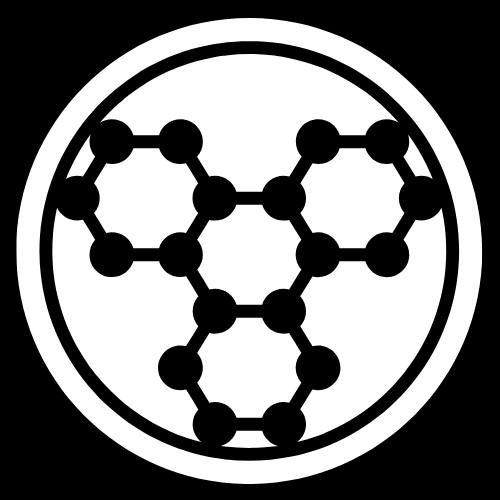

<picture>
  <source media="(prefers-color-scheme: dark)" srcset="/screenshot/NanoPulseOS-Dark.png">
  <source media="(prefers-color-scheme: light)" srcset="/screenshot/NanoPulseOS-Light.png">
  
</picture>

# **NanoPulse OS**: **A NANO Programmed OS that has Pulse**

---

**NanoPulse OS** is a lightweight, portable, live operating system that runs directly from a USB stick (x86-32 i686). It is designed for learning/hobby usage and includes -> generative art, simple retro games, an experimental IDE with a custom esoteric programming language (Crowbar), portability, and reminiscent text style of the past. NanoPulse OS is all about providing a minimal, fun, and interactive environment for exploration and creation. It leaves absolutely no trace on your computer after shutdown.

---

### Build

Check out [Build Instructions](/docs/build-instructions.md)

---

### **How to use/try NanopulseOS**

1. [Download](https://www.nanopulseos.org/) the NanoPulse OS image (once available).
2. Flash the image onto a USB stick using a tool like [Rufus](https://rufus.ie/) or [Balena Etcher](https://www.balena.io/etcher/).
3. Keep "Partition scheme" to MBR and select "Write in DD image mode" after starting (Your device will most likely need Legacy boot ability).
4. Insert the USB stick into any computer and reboot, ensuring the BIOS/UEFI settings allow booting from USB (secure boot off).
5. NanoPulse OS will boot directly from the USB be functional.

You can also try it out on the website which I have added a v86 emulator (Don't ask me how it works -> got it from [here](https://github.com/copy/v86)) in  [nanopulse.org](https://www.nanopulseos.org/).

---

### **Usage**

Type ```help``` into the terminal to see all available commands.

---

### **Specs in Dev**  

- Kernel written in C & x86 Assembly
- Build system uses GCC, Makefile & grubmkrescue for .iso generation
- Graphics is a single framebuffer 32-bit mode
- Uses GRUB for bootloading
- Some posix cmds and mostly just fun little extra features (use ```help```)

---

### **Future Plans?**

- Custom Bootloader, Custom Programming language, Custom Compiler: To make the whole OS unique and mine. Right now I am using GRUB, C, GCC for these purposes. (This is farfetched timeline wise)
- Expanded Game Library: Add more retro games and interactive challenges for users, and do not bake into the kernel like I do now.
- Advanced Scripting Features: Extend the esoteric language to support more complex functionality for users who want to create more advanced programs.
- Performance Optimizations: Tune the OS to ensure smooth performance on a wide range of hardware configurations/compatibility.
- Project: Artifact: Theme it around being a lost old OS, put it on a cheap USB then scatter it around places ARG-style to find.

---

### **Contributing**

If you’re interested in contributing to NanoPulse OS, feel free to fork the repository and submit pull requests. Contributions are welcome, whether it’s improving my (probably) terribly written code or adding cool new features!

---

### Personal note for next steps in work

- Custom Interperator IDE cmd -> eso-interpretor (soon to be added)
- NOTE: absolute no AI used for the creation of this learning project
